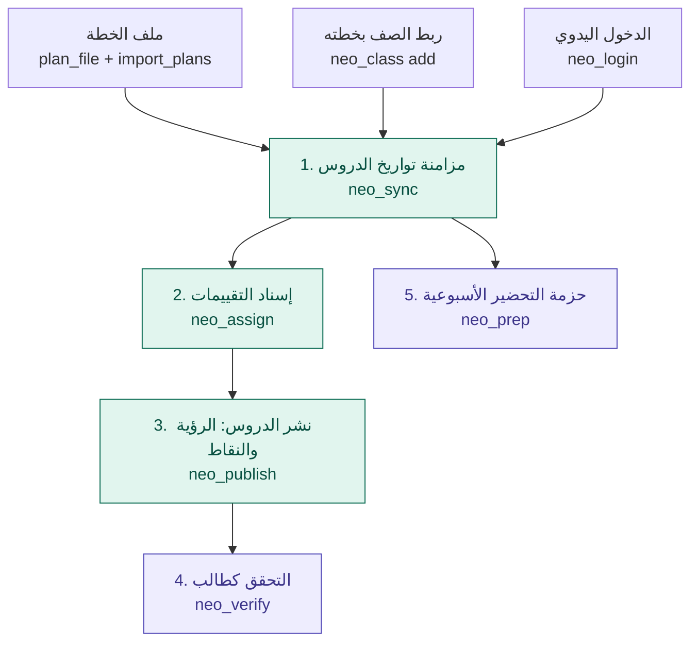

# مهام الأتمتة

الصفوف التي تعمل عليها المهام هي الصفوف المفعّلة في قاعدة البيانات (`neo_class list`). لحصر أي أمر في صف واحد: `--class LMS_ID`. التفاصيل في [reuse_playbook.md](reuse_playbook.md).

## مخطط الأتمتة



- المراحل 1-3 تكتب على المنصة بالنمط نفسه: اقتراح (قراءة فقط) ثم اعتماد المعلم ثم تطبيق. تُقرأ الحالة قبل كل كتابة، ويُتحقق منها بعدها.
- المرحلة 4 قراءة فقط، وتعمل تلقائيًا بعد `neo_publish --apply`، ويمكن تشغيلها وحدها في أي وقت.
- المرحلة 5 قراءة فقط من المنصة، وتكتب على سطح المكتب وحده: مجلد الأسبوع لكل صف.

## المهمة 1: مزامنة تواريخ الدروس مع الخطة الفصلية

الحالة: منفّذة على الصفّين بتاريخ 2026-11-02.

### ما تفعله
تجلب دروس كل صف وجدوله من المنصة، وتطابق كل درس ببند الخطة الفصلية، ثم تقترح لكل درس غير مؤرخ أول حصة متاحة ضمن أسابيع بنده في الخطة. أسبوع الإجازة مستثنى، والحصص المحجوزة لا تُستخدم. لا يُكتب على المنصة إلا ما اعتمده المعلم، والدرس الذي له تاريخ يُتخطّى دائمًا.

### الأوامر
```
python backend/manage.py neo_login                              # دخول يدوي عند انتهاء الجلسة
python backend/manage.py neo_sync                               # جلب + اقتراح (قراءة فقط)
python backend/manage.py neo_sync --apply RUN --approve future  # اعتماد القادمة وكتابتها
python backend/manage.py neo_sync --apply RUN --approve all     # اعتماد الكل وكتابته
```
المراجعة والاعتماد اليدوي متاحان أيضًا من لوحة الإدارة: http://127.0.0.1:8765/admin/neo/dateproposal/

### نتيجة التنفيذ الأول

| | 12/2 | 10/3 |
|---|---|---|
| الدروس | 67، كلها مؤرخة | 47، كلها مؤرخة |
| كتبتها الأتمتة | 32 (عمليات التطبيق #15 و#16 و#17) | 23 (عملية التطبيق #18) |
| بعد التطبيق | كل ما كُتب يطابق الاقتراحات | كل ما كُتب يطابق الاقتراحات |

ملاحظات بعد التنفيذ:
- 12/2: الدرس 27 يشارك الدرس 26 الحصة نفسها (28 سبتمبر، الحصة 2)، لأنه محصور بين درسين مؤرخين بلا حصة شاغرة. حدث هذا بقرار التطبيق على الكل.
- 10/3: الدرسان 19 و20 في حصة واحدة (28 سبتمبر، الحصة 6)، والدرسان 4 و5 مرتبان عكس تاريخيهما. الحالتان موجودتان على المنصة قبل الأتمتة.

### نواقص المنصة مقارنةً بالخطة (لم تُعالَج)
- العاشر: الدرس 2.2 (حل المعادلات بالتحليل إلى العوامل) غير موجود. ولا توجد دروس لمراجعات الوحدتين 2 و3، ولا لمنتصف الفصل، ولا لمشروع STEM، ولا لمراجعة نهاية الفصل.
- الثاني عشر: لا توجد دروس لمراجعات الوحدتين 2 و3، ولا لمراجعة نهاية الفصل.

## المهمة 2: إسناد التقييمات وفق تواريخ الدروس

الحالة: منفّذة على الصفّين بتاريخ 2026-11-02.

### السياسة (اختيار المعلم)
- يظهر التقييم صباح يوم درسه الساعة 07:00، ويستحق بعد يومين الساعة 23:59، ويُقبل التسليم المتأخر.
- تقييمات الدروس الماضية تُسند الآن، ومهلتها يومان من اليوم.
- التقييم المُسند مسبقًا لا يُمس.
- تُضبط في `NEO_ASSIGN_POLICY` داخل `backend/config/settings.py`.

### آلية العمل
- المنصة مفعّل فيها في الصفّين: «تعيين الدرس الحالي تلقائيًا حسب التاريخ» و«إسناد التقييمات تلقائيًا» و«إظهار التقييمات تلقائيًا عند وقت البدء».
- المنصة ترفض إسناد تقييم مرتبط بدرس يأتي بعد الدرس الحالي، وتعرض رسالة «التقييم بعد الدرس الحالي».
- لذلك تضبط الأتمتة وقتَي البداية والاستحقاق لكل التقييمات، وتُسند يدويًا تقييمات الدروس الماضية فقط. أما تقييمات اليوم وما بعده فتُسندها المنصة حين يصير درسها الدرس الحالي.

### الأوامر
```
python backend/manage.py neo_assign                                # جلب + اقتراح (قراءة فقط)
python backend/manage.py neo_assign --apply RUN --approve all      # ضبط المواعيد + إسناد الماضي
python backend/manage.py neo_assign --apply RUN --limit 1          # تجربة على تقييم واحد
```

### نتيجة التنفيذ الأول

| | 10/3 | 12/2 |
|---|---|---|
| التقييمات | 30 | 43 (6 منها كانت مُسندة مسبقًا) |
| ضُبطت مواعيدها | 30 | 37 |
| أُسندت يدويًا (دروس ماضية) | 10 | 15 |
| تنتظر الإسناد التلقائي من المنصة | 20 | 22 |

تحقق بعد التنفيذ: كل التقييمات لها مواعيد، ولا يوجد تقييم لدرس ماضٍ بقي غير مُسند.

## المهمة 3: نشر الدروس للطلاب (الرؤية ونقاط الإنجاز)
الحالة: منفّذة على الصفّين بتاريخ 2026-11-02.

### الفرق بين الأيقونتين في قائمة الدروس
- نجمة «يمنح النقاط»: للدرس إجراء إنجاز يمنح الطالب 5 نقاط في لعبة «نجوم الرياضيات» مع نافذة تهنئة، والدرس ظاهر.
- شخص «شخصى»: الدرس مخفي افتراضيًا، فلا يراه أي طالب، وليس له إجراء نقاط.
- أيقونة الرسم البياني «نتاجات التعلم» مشتركة بين الحالتين، ولا علاقة لها بالرؤية.

ما وُجد على المنصة في 2026-11-02:
- 10/3: الدروس 1–24 ظاهرة وتمنح النقاط. الدروس 25–47 مخفية بلا نقاط، ومنها درس اليوم. الدروس 15–17 ظاهرة بلا نقاط.
- 12/2: الدروس 1–36 ظاهرة وتمنح النقاط. الدروس 37–67 مخفية بلا نقاط.

### السياسة (اختيار المعلم)
- يظهر كل درس له تاريخ.
- كل درس بلا إجراء نقاط يُضاف له ما للدروس الأولى: 5 نقاط في «نجوم الرياضيات» بنافذة ورسالة جاهزة.
- الإجراء القائم لا يُعدَّل ولا يُكرَّر، واستثناءات الإخفاء لطلاب بعينهم تبقى.
- تُضبط عامةً في `NEO_PUBLISH_POLICY` داخل `backend/config/settings.py`. ولكل صف أن يحدد لعبته ونقاطه في الحقلين `points_game` و`points` من لوحة الإدارة، والفارغ يأخذ القيمة العامة.
- يُفحص وجود اللعبة في الصف عند الاقتراح وقبل التطبيق. إن لم توجد، يُقترح الإظهار وحده، ويظهر السبب في `points_error`.

### آلية العمل
- الرؤية تُقرأ من تبويب «الرؤية» لكل درس مؤرخ عند الاقتراح، لا من شارة «شخصى»؛ ثبت أن الشارة قد تبقى على درس ظاهر (الدرس 31). والنقاط تُقرأ من شارة «يمنح النقاط».
- قبل كل كتابة تُقرأ الحالة الفعلية من تبويب «الرؤية» `/teacher_lesson/shown/` وتبويب «متطلبات الإنجاز» `/teacher_lesson/completion/`، ثم يُتحقق منها بعد الكتابة.
- الإظهار: `/teacher_lesson/set_shown_default/{id}?lesson_id=N&value=Show`، وهو ما يفعله اختيار «ظاهر».
- النقاط: نموذج «إجراءات الإنجاز ← إضافة ← منح النقاط» `/teacher_lesson/new_rule_action/`.

### الأوامر
```
python backend/manage.py neo_publish                               # جلب + اقتراح (قراءة فقط)
python backend/manage.py neo_publish --apply RUN --limit 1 --approve all   # تجربة على درس واحد
python backend/manage.py neo_publish --apply RUN                   # تطبيق بقية المعتمد
```

### نتيجة التنفيذ الأول

| | 10/3 | 12/2 |
|---|---|---|
| أُظهرت | 23 (الدروس 25–47) | 31 (الدروس 37–67) |
| أُضيفت لها النقاط | 26 (منها 15–17 الظاهرة) | 31 |
| فشل | 0 | 0 |

تحقق بعد التنفيذ: كل دروس الصفّين تمنح النقاط، وتبويب «الرؤية» في كل درس «ظاهر» بلا استثناءات.
ملاحظة: الدرس 31 في 10/3 بقيت على بطاقته شارة «شخصى»، مع أن تبويب رؤيته «ظاهر» بلا تصفية ولا استثناء.
الشارة إذن ليست دليلًا كافيًا على الإخفاء؛ المرجع تبويب «الرؤية»، والتطبيق يقرؤه قبل كل كتابة.

## المهمة 4: التحقق من منظور الطالب (قراءة فقط)
تفتح الصف «كطالب عام» عبر «عرض الصف كطالب»، ولا يُسجَّل بذلك دخول ولا إنجاز. ثم تعود إلى عرض المعلم وتقارن ما يراه الطالب بالمتوقع:
- **مفقود** (فشل): درس ظاهر عندنا تاريخه ماضٍ، والطالب لا يراه.
- **درس اليوم**: يكفي ظهوره في لوحة «اليوم»، لأن بطاقته تظهر عند موعد حصته.
- **مجدول**: درس مستقبلي تكشفه المنصة في موعده، فيُذكر للمتابعة ولا يُعد خطأً.
- **مخفي ويُرى**: درس مخفي عندنا لكن الطالب يراه.

تنبيه: المنصة تبدّل كوكي الجلسة عند الدخول إلى عرض الطالب، فيجب حفظه بعد العودة، وإلا انتهت الجلسة. العميل يفعل ذلك.

```
python backend/manage.py neo_verify                  # كل الصفوف المفعّلة
python backend/manage.py neo_verify --class 602598
```

ما لوحظ في 2026-11-02 في 10/3: قبل الظهر رأى الطالب بطاقات الدروس 1–27، ودرس اليوم (28) في لوحة «اليوم» فقط. وبعد الظهر صار يرى 28 بطاقة.
هذا يؤكد أن المنصة تكشف الدرس الظاهر عند موعده. فالدروس المستقبلية لا تحتاج تدخلًا، ويكفي أن تكون «ظاهرة».

نتيجة التشغيل الأول (التحقق #40 و#41): الصفّان سليمان، ولا يوجد درس ماضٍ لا يراه الطالب.
- 10/3: يرى الطالب 28 درسًا، وهناك 18 درسًا مجدولًا، والدرس 31 تحت المتابعة لأن أيقونة «شخصى» باقية عليه.
- 12/2: يرى الطالب 46 درسًا، وهناك 21 درسًا مجدولًا.

الجلسة تبقى صالحة بعد التحقق.

## المهمة 5: حزمة التحضير الأسبوعية (قراءة فقط)

الحالة: منفّذة للصف 12/2 الأسبوع 11 بتاريخ 2026-11-04، من الواجهة (اليوم ← حزمة التحضير الأسبوعية) أو بالأمر.

### ما تفعله
لصف وأسبوع من الخطة، تبني على سطح المكتب مجلد الأسبوع `W011 - 12-2`، وفيه لكل درس مجلد `49 - الدوال المتزايدة والمتناقصة 2`:
- من «ملاحظات المعلم»: ملف التحضير (`التحضير - …docx`) والعرض (`عرض الدرس - …pptx`) وورقة العمل (`ورقة عمل - …docx`)، باسم الرابط كما يراه المعلم.
- عروض أقسام الدرس من نوع العرض في `عروض الأقسام/1 - <اسم القسم>.pptx`.
- التحضير معدّلًا: العام الدراسي في كل الأجزاء (ومنها مربعات النص وخصائص الغلاف في customXml التي يعيد Word منها كتابة التذييل)، واسم المعلم، واليوم والتاريخ، وصف جدول المتابعة (الشعبة واليوم والتاريخ والحصة). وورقة العمل: تاريخها الناقص (`--/11/2024`، `-----11-2024`) يصير تاريخ الدرس. المحتوى لا يُمس.
- `الرسالة الأسبوعية.txt`: صف الرسالة بأعمدة نموذج المدرسة (الصف، الموضوع، صفحات الكتاب، الواجبات، الاختبارات، التوقيع)، وفي الواجهة زر «نسخ الصف» يلصقه في وورد صفًّا في جدول.

### القرار الحاسم: دروس الأسبوع من الخطة لا من تواريخ المنصة
- عدد الدروس = مجموع حصص بنود الأسبوع في الخطة، والأجزاء تبدأ بعد ما استهلكته الأسابيع السابقة من كل موضوع. مثال الأسبوع 11 للصف 12/2: «المتزايدة» حصة في الأسبوع 10، فالأسبوع 11 = المتزايدة 2، 3، 4 + القيم القصوى 1، 2، 3.
- الربط بدروس المنصة بالموضوع ورقم الجزء (رمز المطابقة، وإلا العنوان بلا رقمه)، لا بتاريخ المنصة؛ تواريخ المنصة هنا تسبق الخطة بدرسين، ويذكرها التقرير.
- اليوم والحصة من جدول الصف بالترتيب. إن نقص درس على المنصة أو اختلف عدد الدروس عن عدد الحصص (يوم إجازة مثلًا) تتوقف الحزمة قبل أي تنزيل وتطلب قرار المعلم.

### الأوامر
```
python backend/manage.py neo_prep --class 602728 --week 11            # الحزمة على سطح المكتب
python backend/manage.py neo_prep --class 602728 --week 11 --dest D:\x  # وجهة أخرى
python backend/manage.py neo_prep --class 602728 --week 11 --no-word   # بلا فتح Word
```
التقرير الكامل يُكتب ملف UTF-8 في `backend/media/prep_cache/reports/` لأن الطرفية تشوّه العربية.

### الإعدادات
- `NEO_PREP` في `backend/config/settings.py`: نمط اسم مجلد الأسبوع (`W{week:03d} - {section}`، فلا يتداخل صفّان في الأسبوع نفسه)، والوجهة (فارغة = `[Environment]::GetFolderPath('Desktop')`، وهي هنا OneDrive\Desktop)، والتحقق بـ Word.
- اسم المعلم في `backend/config/local.json` (خارج المستودع): `{"teacher_name": "…"}`.
- صفحات الكتاب في `BOOKS` داخل `neo/domain/weekly_pack.py` لكل كتاب بعد التحقق مرة واحدة (صفحة الكتاب = صفحة PDF − 8 لكتاب 12 علمي ف1): 3.1 = 144–153، و3.2 = 154–168 (أجزاء الأسبوع 11 حتى 163). الدرس الذي لا صفحات له يذكره التقرير.

### الأمان والتكرار
- قراءة فقط من المنصة، بتمهّل 3–6 ث بين الطلبات، وإعادة المحاولة عند 429 بعد 5 ثم 20 ثم 35 ث.
- الأصل يُنزَّل إلى `backend/media/prep_cache/files/` ويُنسخ ثم يُعدَّل منه دائمًا، فالتشغيل الثاني لا ينزّل شيئًا وينتج الملفات نفسها بايتًا ببايت (يقارن التقرير البصمات). لا يُحذف شيء من مجلد المعلم؛ الملفات الزائدة تُذكر فقط.

### التحقق (في كل تشغيل)
- فحص نصي لكل أجزاء `word/` و`customXml`: لا يبقى 2024 ولا 2025.
- ملف من كل قالب («خطة درس» و«الخطة اليومية») يُفتح في Word ويُصدَّر PDF إلى `prep_cache/verify/`، وتُفحص نصوصه كما يعرضها Word (ومنها التذييل المربوط) وجدولا الرأس والمتابعة.

### نتيجة التنفيذ الأول (12/2، الأسبوع 11)
- ستة دروس (49–54) في 8–12/11/2026، الحصص 5، 2، 3، 5، 4، 6. 29 ملفًا.
- مطابق للمجلد اليدوي `W011`: الأسماء الـ 29 نفسها، والعروض متطابقة بايتًا ببايت، والتحضيرات وأوراق العمل متطابقة نصًّا.
- تشغيل من الصفر (ذاكرة مؤقتة ووجهة فارغتان) ثم تشغيل ثانٍ: لا تنزيل، والبصمات مطابقة.
- ما يذكره التقرير للمعلم: الدرس 49 بلا ورقة عمل؛ أوراق عمل 52–54 عناوينها لا تذكر موضوع الدرس (الاتصال، متوسط معدل التغير)؛ تواريخ المنصة للدروس 49–54 تسبق الخطة.

### بقي (بقرار المعلم)
- إضافتها إلى الدورة الأسبوعية (الخميس 14:00) لتوليد حزمة الأسبوع التالي وتقريرها: غير مفعّلة حتى يقرر المعلم.

## ملاحظات تشغيل عامة
- تبويب «مباشر» في الموقع (`/app/live`) يعرض ما يفعله العامل لحظة بلحظة: المهمة الجارية بمراحلها وتقدّمها وزمنها، وكل طلب للمنصة وكل ملف، والتنبيهات (ومنها 429)، والطابور، وآخر المهام تُعاد مشاهدتها بالنقر. مصدره بثّ يكتبه العامل لكل مهمة في `backend/media/live/job_<id>.jsonl` بلا قاعدة البيانات، ويُحتفظ بآخر 300 مهمة. الصفحة تقرأ فقط.
- لا يعمل أمران معًا: ملف الدخول يُقفل ما دام أمر يعمل، فيرفض الأمر الثاني برسالة «المتصفح مشغول». انتظر انتهاء الأول، ومنه نافذة `neo_login`.
