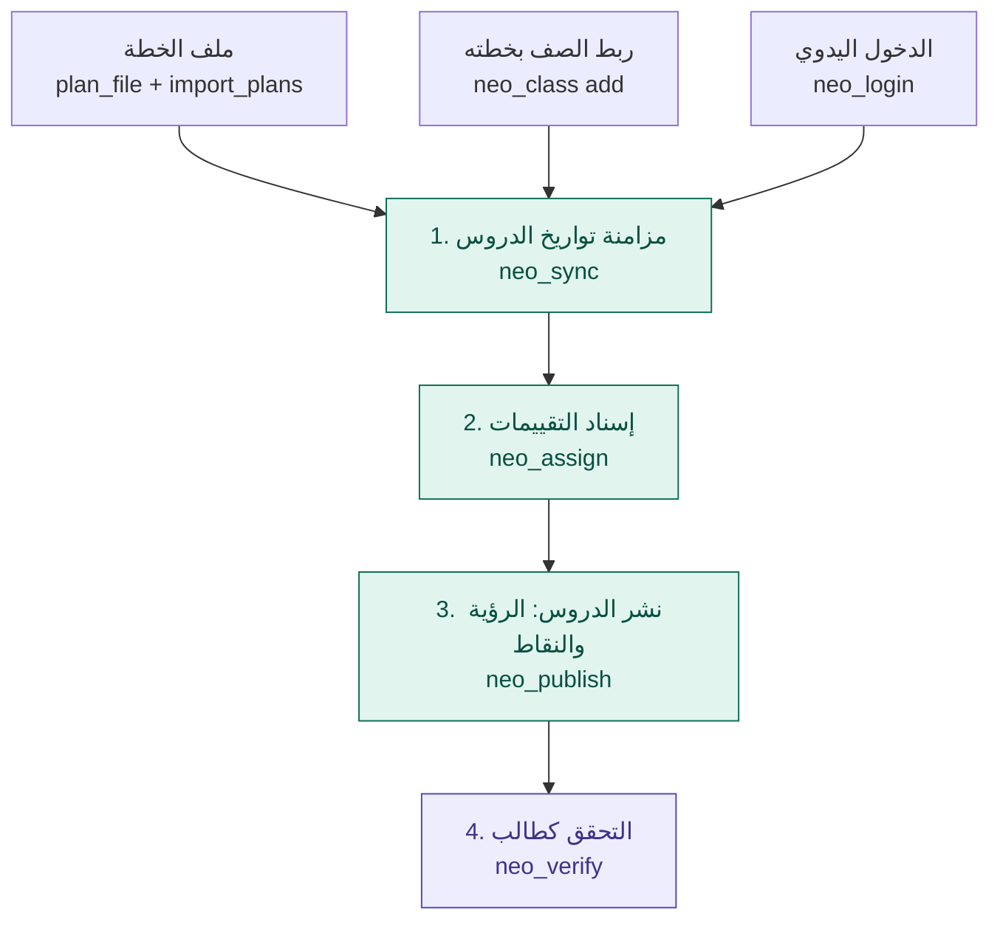

# مهام الأتمتة

الصفوف التي تعمل عليها المهام هي الصفوف المفعّلة في قاعدة البيانات (`neo_class list`). لحصر أي أمر في صف واحد: `--class LMS_ID`. التفاصيل في [reuse_playbook.md](reuse_playbook.md).

## مخطط الأتمتة



- المراحل 1-3 تكتب على المنصة بالنمط نفسه: اقتراح (قراءة فقط) ثم اعتماد المعلم ثم تطبيق. تُقرأ الحالة قبل كل كتابة، ويُتحقق منها بعدها.
- المرحلة 4 قراءة فقط، وتعمل تلقائيًا بعد `neo_publish --apply`، ويمكن تشغيلها وحدها في أي وقت.

## المهمة 1: مزامنة تواريخ الدروس مع الخطة الفصلية

الحالة: منفّذة على الصفّين بتاريخ 2026-11-02.

### ما تفعله
تجلب دروس كل صف وجدوله من المنصة، وتطابق كل درس ببند الخطة الفصلية، ثم تقترح لكل درس غير مؤرخ أول حصة متاحة ضمن أسابيع بنده في الخطة. أسبوع الإجازة مستثنى، والحصص المحجوزة لا تُستخدم. لا يُكتب على المنصة إلا ما اعتمده المعلم، والدرس الذي له تاريخ يُتخطّى دائمًا.

### الأوامر
```
python backend/manage.py neo_login                              # دخول يدوي عند انتهاء الجلسة
python backend/manage.py neo_sync                               # جلب + اقتراح (قراءة فقط)
python backend/manage.py neo_sync --apply RUN --approve future  # اعتماد القادمة وكتابتها
python backend/manage.py neo_sync --apply RUN --approve all     # اعتماد الكل وكتابته
```
المراجعة والاعتماد اليدوي متاحان أيضًا من لوحة الإدارة: http://127.0.0.1:8765/admin/neo/dateproposal/

### نتيجة التنفيذ الأول

| | 12/2 | 10/3 |
|---|---|---|
| الدروس | 67، كلها مؤرخة | 47، كلها مؤرخة |
| كتبتها الأتمتة | 32 (عمليات التطبيق #15 و#16 و#17) | 23 (عملية التطبيق #18) |
| بعد التطبيق | كل ما كُتب يطابق الاقتراحات | كل ما كُتب يطابق الاقتراحات |

ملاحظات بعد التنفيذ:
- 12/2: الدرس 27 يشارك الدرس 26 الحصة نفسها (28 سبتمبر، الحصة 2)، لأنه محصور بين درسين مؤرخين بلا حصة شاغرة. حدث هذا بقرار التطبيق على الكل.
- 10/3: الدرسان 19 و20 في حصة واحدة (28 سبتمبر، الحصة 6)، والدرسان 4 و5 مرتبان عكس تاريخيهما. الحالتان موجودتان على المنصة قبل الأتمتة.

### نواقص المنصة مقارنةً بالخطة (لم تُعالَج)
- العاشر: الدرس 2.2 (حل المعادلات بالتحليل إلى العوامل) غير موجود. ولا توجد دروس لمراجعات الوحدتين 2 و3، ولا لمنتصف الفصل، ولا لمشروع STEM، ولا لمراجعة نهاية الفصل.
- الثاني عشر: لا توجد دروس لمراجعات الوحدتين 2 و3، ولا لمراجعة نهاية الفصل.

## المهمة 2: إسناد التقييمات وفق تواريخ الدروس

الحالة: منفّذة على الصفّين بتاريخ 2026-11-02.

### السياسة (اختيار المعلم)
- يظهر التقييم صباح يوم درسه الساعة 07:00، ويستحق بعد يومين الساعة 23:59، ويُقبل التسليم المتأخر.
- تقييمات الدروس الماضية تُسند الآن، ومهلتها يومان من اليوم.
- التقييم المُسند مسبقًا لا يُمس.
- تُضبط في `NEO_ASSIGN_POLICY` داخل `backend/config/settings.py`.

### آلية العمل
- المنصة مفعّل فيها في الصفّين: «تعيين الدرس الحالي تلقائيًا حسب التاريخ» و«إسناد التقييمات تلقائيًا» و«إظهار التقييمات تلقائيًا عند وقت البدء».
- المنصة ترفض إسناد تقييم مرتبط بدرس يأتي بعد الدرس الحالي، وتعرض رسالة «التقييم بعد الدرس الحالي».
- لذلك تضبط الأتمتة وقتَي البداية والاستحقاق لكل التقييمات، وتُسند يدويًا تقييمات الدروس الماضية فقط. أما تقييمات اليوم وما بعده فتُسندها المنصة حين يصير درسها الدرس الحالي.

### الأوامر
```
python backend/manage.py neo_assign                                # جلب + اقتراح (قراءة فقط)
python backend/manage.py neo_assign --apply RUN --approve all      # ضبط المواعيد + إسناد الماضي
python backend/manage.py neo_assign --apply RUN --limit 1          # تجربة على تقييم واحد
```

### نتيجة التنفيذ الأول

| | 10/3 | 12/2 |
|---|---|---|
| التقييمات | 30 | 43 (6 منها كانت مُسندة مسبقًا) |
| ضُبطت مواعيدها | 30 | 37 |
| أُسندت يدويًا (دروس ماضية) | 10 | 15 |
| تنتظر الإسناد التلقائي من المنصة | 20 | 22 |

تحقق بعد التنفيذ: كل التقييمات لها مواعيد، ولا يوجد تقييم لدرس ماضٍ بقي غير مُسند.

## المهمة 3: نشر الدروس للطلاب (الرؤية ونقاط الإنجاز)
الحالة: منفّذة على الصفّين بتاريخ 2026-11-02.

### الفرق بين الأيقونتين في قائمة الدروس
- نجمة «يمنح النقاط»: للدرس إجراء إنجاز يمنح الطالب 5 نقاط في لعبة «نجوم الرياضيات» مع نافذة تهنئة، والدرس ظاهر.
- شخص «شخصى»: الدرس مخفي افتراضيًا، فلا يراه أي طالب، وليس له إجراء نقاط.
- أيقونة الرسم البياني «نتاجات التعلم» مشتركة بين الحالتين، ولا علاقة لها بالرؤية.

ما وُجد على المنصة في 2026-11-02:
- 10/3: الدروس 1–24 ظاهرة وتمنح النقاط. الدروس 25–47 مخفية بلا نقاط، ومنها درس اليوم. الدروس 15–17 ظاهرة بلا نقاط.
- 12/2: الدروس 1–36 ظاهرة وتمنح النقاط. الدروس 37–67 مخفية بلا نقاط.

### السياسة (اختيار المعلم)
- يظهر كل درس له تاريخ.
- كل درس بلا إجراء نقاط يُضاف له ما للدروس الأولى: 5 نقاط في «نجوم الرياضيات» بنافذة ورسالة جاهزة.
- الإجراء القائم لا يُعدَّل ولا يُكرَّر، واستثناءات الإخفاء لطلاب بعينهم تبقى.
- تُضبط في `NEO_PUBLISH_POLICY` داخل `backend/config/settings.py`.

### آلية العمل
- الحالة تُقرأ من شارات بطاقات الدروس في قائمة الدروس.
- قبل كل كتابة تُقرأ الحالة الفعلية من تبويب «الرؤية» `/teacher_lesson/shown/` وتبويب «متطلبات الإنجاز» `/teacher_lesson/completion/`، ثم يُتحقق منها بعد الكتابة.
- الإظهار: `/teacher_lesson/set_shown_default/{id}?lesson_id=N&value=Show`، وهو ما يفعله اختيار «ظاهر».
- النقاط: نموذج «إجراءات الإنجاز ← إضافة ← منح النقاط» `/teacher_lesson/new_rule_action/`.

### الأوامر
```
python backend/manage.py neo_publish                               # جلب + اقتراح (قراءة فقط)
python backend/manage.py neo_publish --apply RUN --limit 1 --approve all   # تجربة على درس واحد
python backend/manage.py neo_publish --apply RUN                   # تطبيق بقية المعتمد
```

### نتيجة التنفيذ الأول

| | 10/3 | 12/2 |
|---|---|---|
| أُظهرت | 23 (الدروس 25–47) | 31 (الدروس 37–67) |
| أُضيفت لها النقاط | 26 (منها 15–17 الظاهرة) | 31 |
| فشل | 0 | 0 |

تحقق بعد التنفيذ: كل دروس الصفّين تمنح النقاط، وتبويب «الرؤية» في كل درس «ظاهر» بلا استثناءات.
ملاحظة: الدرس 31 في 10/3 بقيت على بطاقته شارة «شخصى»، مع أن تبويب رؤيته «ظاهر» بلا تصفية ولا استثناء.
الشارة إذن ليست دليلًا كافيًا على الإخفاء؛ المرجع تبويب «الرؤية»، والتطبيق يقرؤه قبل كل كتابة.

## المهمة 4: التحقق من منظور الطالب (قراءة فقط)
تفتح الصف «كطالب عام» عبر «عرض الصف كطالب»، ولا يُسجَّل بذلك دخول ولا إنجاز. ثم تعود إلى عرض المعلم وتقارن ما يراه الطالب بالمتوقع:
- **مفقود** (فشل): درس ظاهر عندنا تاريخه ماضٍ، والطالب لا يراه.
- **درس اليوم**: يكفي ظهوره في لوحة «اليوم»، لأن بطاقته تظهر عند موعد حصته.
- **مجدول**: درس مستقبلي تكشفه المنصة في موعده، فيُذكر للمتابعة ولا يُعد خطأً.
- **مخفي ويُرى**: درس مخفي عندنا لكن الطالب يراه.

تنبيه: المنصة تبدّل كوكي الجلسة عند الدخول إلى عرض الطالب، فيجب حفظه بعد العودة، وإلا انتهت الجلسة. العميل يفعل ذلك.

```
python backend/manage.py neo_verify                  # كل الصفوف المفعّلة
python backend/manage.py neo_verify --class 602598
```

ما لوحظ في 2026-11-02 في 10/3: قبل الظهر رأى الطالب بطاقات الدروس 1–27، ودرس اليوم (28) في لوحة «اليوم» فقط. وبعد الظهر صار يرى 28 بطاقة.
هذا يؤكد أن المنصة تكشف الدرس الظاهر عند موعده. فالدروس المستقبلية لا تحتاج تدخلًا، ويكفي أن تكون «ظاهرة».

نتيجة التشغيل الأول (التحقق #40 و#41): الصفّان سليمان، ولا يوجد درس ماضٍ لا يراه الطالب.
- 10/3: يرى الطالب 28 درسًا، وهناك 18 درسًا مجدولًا، والدرس 31 تحت المتابعة لأن أيقونة «شخصى» باقية عليه.
- 12/2: يرى الطالب 46 درسًا، وهناك 21 درسًا مجدولًا.

الجلسة تبقى صالحة بعد التحقق.
